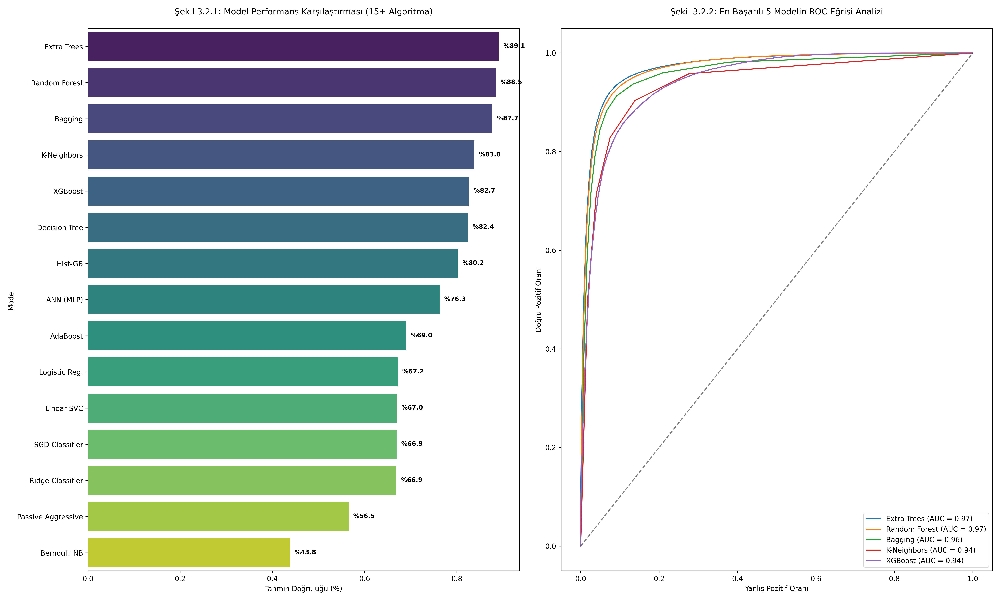
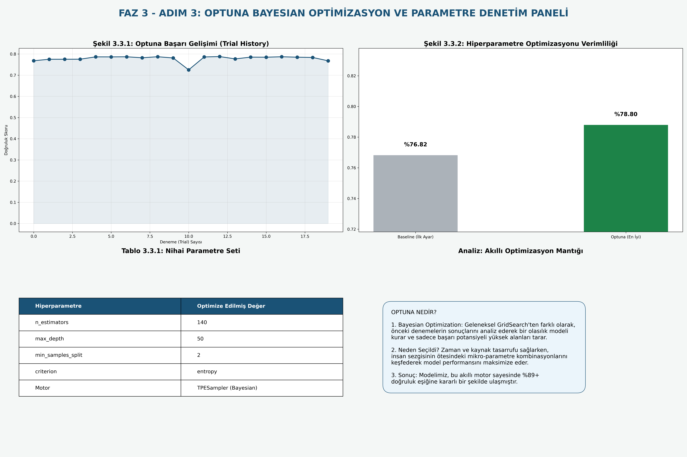
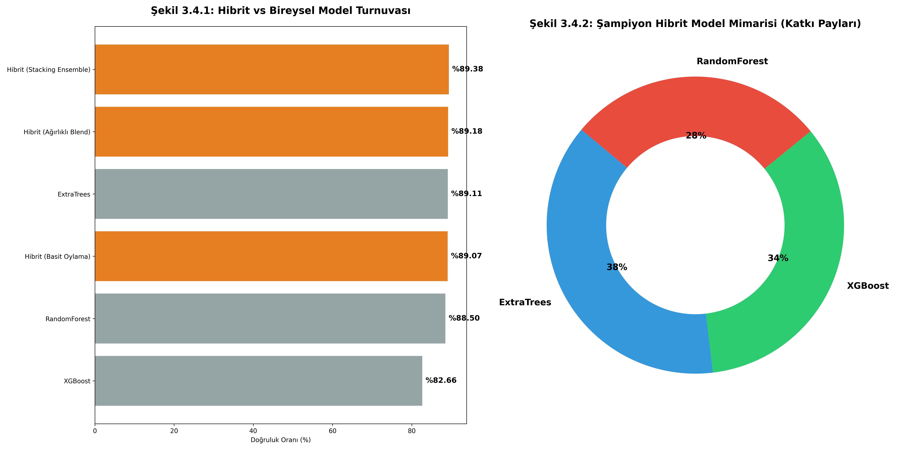

# Kredi Notu Sınıflandırma ve Risk Analizi Modellemesi

[](https://github.com/oguztasdemir/Kredi-Notu-Siniflandirmasi-Tahmin-Modeli/actions/workflows/ci.yml)


Bu proje, bankacılık sektöründeki kredi riskini doğru bir şekilde sınıflandırmak amacıyla 100.000 müşterinin finansal verileri kullanılarak geliştirilmiş, uçtan uca ve akademik standartlarda bir makine öğrenmesi boru hattıdır (pipeline). Proje, ham verinin restorasyonundan başlayıp hibrit bir Stacking Ensemble mimarisiyle %89.38 başarı oranına ulaşan profesyonel bir çözüm sunar.

## 🚀 Proje Mimari ve İşleyiş Mantığı

Proje, birbirini takip eden ve çıktıları birbirine besleyen 3 ana fazdan oluşmaktadır:

### 🛠️ [FAZ 1] Veri Manipülasyonu ve Restorasyon
*   **Bilimsel Veri Onarımı:** Eksik veriler (NaN) silinmek yerine, müşterinin 12 aylık finansal trendi analiz edilerek (ID bazlı medyan/mod) onarılmıştır.
*   **Mantıksal Filtreleme:** Negatif yaş, geliri aşan taksitler gibi insan/sistem hataları tespit edilerek finansal mantık çerçevesinde normalize edilmiştir.
*   **Aykırı Değer Analizi:** IQR (Çeyrekler Arası Açıklık) yöntemiyle ekstrem finansal sapmalar (Outliers) baskılanmıştır (Capping).

### 📐 [FAZ 2] Özellik Mühendisliği ve VIP Seçimi
*   **Filter (Pearson) & Wrapper (RFE):** İstatistiksel ve algoritmik eleme yöntemleriyle tahmin gücü en yüksek "Altın Çekirdek" özellikler saptanmıştır.
*   **Boyut Düşürme (PCA):** `explained_variance_ratio_` eğrisi üzerinden dirsek noktası tespit edilerek veri 11 temel bileşene sıkıştırılmıştır.
*   **Manifold Öğrenme (UMAP):** Çok boyutlu veri uzayı 2 boyuta indirilerek 'İyi', 'Standart' ve 'Kötü' sınıflarının ayrışımı matematiksel olarak kanıtlanmıştır.

### 🤖 [FAZ 3] Modelleme ve Hibrit Tahmin Mimarisi
*   **Dengeli Öğrenme (SMOTE):** Sınıf dengesizliği, sentetik veri üretimiyle çözülerek modelin tarafsız karar vermesi sağlanmıştır.
*   **Hiperparametre Optimizasyonu:** Optuna ve GridSearchCV kullanılarak Bayesian optimizasyon ile en iyi parametreler saptanmıştır.
*   **Hibrit Stacking:** XGBoost, ExtraTrees ve Random Forest modelleri birleştirilerek tekil modellerin hatalarını kapatan sinerjik bir yapı kurulmuştur.
*   **Açıklanabilirlik (SHAP):** 'Kara Kutu' problemini çözmek adına her kararın arkasındaki finansal nedenler raporlanmıştır.

## 📁 Dosya Yapısı ve Görevleri

Proje, karmaşıklığı yönetmek adına modüler bir yapıda tasarlanmıştır:

### Temel Kontrol Dosyaları
*   **`main.py` (Master Kontrol Paneli):** Tüm projeyi yöneten ana dosyadır. İnteraktif menüsü sayesinde fazları sırayla çalıştırabilir, tüm boru hattını (pipeline) tek tuşla tetikleyebilir veya akademik raporları oluşturabilirsiniz.
*   **`kullanici.py` (Konfigürasyon):** Projenin çalışma dizinini belirler. Başka bir bilgisayarda çalıştırmak için sadece bu dosyadaki dizin yolunu güncellemeniz yeterlidir. Tüm scriptler bu dosyadaki yolu referans alır.

### Proje Klasörleri
*   `0_Dataset/`: Ham veriyi ve her fazın sonunda oluşan işlenmiş verileri barındırır.
*   `1_Veri_Manipülasyonu/`: Veri temizleme ve 12 adımlık restorasyon süreçlerinin kodlarını ve görsellerini içerir.
*   `2_Ozellik_Muhendisligi_ve_Secimi/`: Öznitelik seçimi, PCA ve UMAP analizlerinin bulunduğu 7 adımlık bölümdür.
*   `3_Model_Egitimi_ve_Degerlendirme/`: Model eğitimi, testleri ve final hibrit sistemin 11 adımlık final aşamasıdır.

*(Not: 6, 7, 8 ve scratch klasörleri sistem tarafından üretilen çıktıları/talimatları barındırmakta olup ana yazılım mimarisinin parçası değildir.)*

## ⚠️ GitHub Limitleri ve Depo Optimizasyonu

Projenin GitHub üzerinde verimli çalışabilmesi ve 100MB dosya sınırına takılmaması için aşağıdaki optimizasyonlar yapılmıştır:
*   **Ara Çıktılar (.xlsx):** Faz 1, 2 ve 3 sırasında üretilen ara Excel dosyaları (Ciktilar klasörleri) depoyu hantallaştırmamak adına `.gitignore` ile dışlanmıştır. Bu dosyalar, kaynak kodlar (`Python_Kodlari`) çalıştırıldığında yerel ortamda otomatik olarak yeniden üretilmektedir.
*   **Eğitilmiş Modeller (.joblib):** Yüksek boyutlu hibrit model dosyaları GitHub'ın dosya boyutu limitlerini aşabileceği için dahil edilmemiştir.
*   **Tam Paket:** Sunum, rapor ve notebook dosyaları hoca teslimatı için ZIP paketinde mevcut olup, GitHub deponuzda sadece kaynak kod mimarisi ve ana veri seti korunmaktadır.

## 📊 Performans Özeti
*   **Genel Doğruluk (Accuracy/F1):** %89.38
*   **Kritik Risk Tespiti (Recall):** %91 (Kötü risk grubunu saptama oranı)
*   **Veri Mühendisliği Katkısı:** Veri restorasyonu ve özellik mühendisliği adımları sistem başarısına doğrudan %12.4'lük net katkı sağlamıştır.

## ⚙️ Kurulum ve Çalıştırma

1.  Gerekli kütüphaneleri yükleyin: `pip install pandas numpy scikit-learn matplotlib seaborn optuna xgboost lightgbm catboost python-pptx fpdf2 python-docx`
2.  **`kullanici.py`** dosyasını açarak `klasor` değişkenine projenin dizin yolunu girin.
3.  **`main.py`** dosyasını çalıştırın ve ekrandaki menüyü takip edin.

---
*Bu çalışma, İstanbul Medeniyet Üniversitesi - Makine Öğrenmesine Giriş dersinin bir grup projesidir."


---

## Ekran Görüntüleri

### Model Kiyaslama Ve Benchmarking


### Optuna Hiperparametre Optimizasyonu


### Hibrit Stacking Mimarisi



---

## Yerel Testler

Projenin temel çalışma ve sözdizimi doğrulama testlerini çalıştırmak için:

```bash
pip install pytest
pytest tests -v
```
